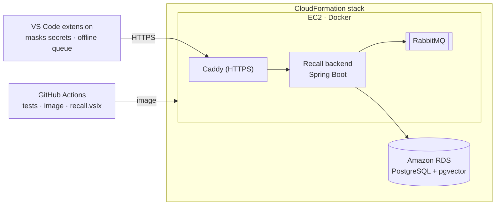

<h1 align="center">Recall</h1>

<p align="center">
  <b>Your team's terminal history, as shared and searchable knowledge, running on AWS.</b><br>
  Ask in plain words, get the one command your teammates used. Hit an error, get the fix they found.
</p>

<p align="center">
  
  
  
  
  
  
</p>

<p align="center">
  <a href="#-deploy-on-aws">Deploy on AWS</a> ·
  <a href="#-connect-vs-code">Connect VS Code</a> ·
  <a href="#-using-recall">Using Recall</a> ·
  <a href="https://github.com/bhargavchetanya/recall-playground">Team playground</a> ·
  <a href="report/Recall-on-AWS-Report.pdf">Project report</a>
</p>

---

## ✨ What Recall does

| | |
|---|---|
| 🔎 **Search by meaning** | Press <kbd>Ctrl</kbd>+<kbd>Alt</kbd>+<kbd>R</kbd>, type *"undo my last commit but keep the changes"*, and get **one** command from your team's history (`git reset --soft HEAD~1`), with who used it and when. |
| 🩹 **Fixes your team already found** | When a command fails, Recall checks whether a teammate hit the same error and offers their fix in a notification. |
| 🧠 **Learns on its own** | Nobody writes anything down. When a command fails and the next one that works fixes it, that command becomes the team's fix. |
| 🔒 **Private** | Passwords and tokens are masked before anything leaves VS Code, and again on the server. Each team sees only its own history. |
| 📴 **Works offline** | Commands queue in VS Code while the server is unreachable and are sent when it is back. |

## 🏗️ How it works



The extension sends each finished terminal command (secrets masked) to the backend. A worker stores it, embeds it with
a local model (all-MiniLM-L6-v2) for search by meaning, fingerprints errors and learns fixes. Only HTTPS is public;
the database accepts connections only from the app server. Details: [docs/ARCHITECTURE.md](docs/ARCHITECTURE.md).

---

## 🚀 Deploy on AWS

One CloudFormation template, [`deploy/aws/recall.yaml`](deploy/aws/recall.yaml), builds everything in about 9 minutes.
It is sized for the AWS Academy sandbox (t3.small, us-east-1, `vockey`, `LabInstanceProfile`).

1. AWS Console → **CloudFormation** → **Create stack** → **Upload a template file** → `deploy/aws/recall.yaml`.
2. Stack name `recall`, keep every parameter → **Next** → **Next** → **Submit**.
3. Wait for **CREATE_COMPLETE**. The stack completes only once Recall answers its health check.
4. **Outputs** → open **RecallUrl** (for example `https://3-80-65-109.sslip.io`). The page shows a demo invite code and
   demo accounts.

In an AWS Academy sandbox everything is deleted when the session ends: create the stack again next time (the address
changes). The full guide, with an instructor demo script, troubleshooting and costs:
[docs/DEPLOY_AWS.md](docs/DEPLOY_AWS.md).

## 🧩 Connect VS Code

1. Download `recall.vsix` from the [latest release](https://github.com/bhargavchetanya/Recall-cloud-/releases/latest).
   In VS Code: **Extensions** → **⋯** → **Install from VSIX…** → reload.
2. Command Palette (<kbd>Ctrl</kbd>/<kbd>Cmd</kbd>+<kbd>Shift</kbd>+<kbd>P</kbd>) → **Recall: Set server URL** → paste
   the RecallUrl.
3. **Recall: Sign in** → pick one:
   - **Create a team**: you get an **invite code** for your teammates;
   - **Join a team**: enter a teammate's invite code;
   - **Sign in**: you already have an account (the demo accounts are on the landing page).
4. The status bar (bottom left) shows **`Recall ●`**. Work in VS Code's terminal as usual.

Trying it with friends? [recall-playground](https://github.com/bhargavchetanya/recall-playground) is a tiny project with
8 challenges: one friend fixes each problem, the next one gets the fix from Recall.

---

## 🧑‍💻 Using Recall

| Command | Shortcut | What it does |
|---|---|---|
| **Recall: Search…** | <kbd>Ctrl</kbd>+<kbd>Alt</kbd>+<kbd>R</kbd> (<kbd>Cmd</kbd>+<kbd>Alt</kbd>+<kbd>R</kbd>) | Ask in plain words; get one command from your team |
| **Recall: Show last fix** | | The last fix Recall offered, with who fixed it |
| **Recall: Set server URL** | | Point VS Code at a Recall server; asks you to sign in there |
| **Recall: Sign in** / **Sign out** | | Log in, join or create a team / log out |
| **Recall: Toggle capture** | | Pause or resume sharing your terminal commands |
| **Recall: Send queued events now** | | Send commands queued while offline |
| **Recall: Show menu** | click the status bar | Every Recall action |
| **Recall: Show log** | | What Recall is doing, for troubleshooting |

On a result card, **Insert into terminal** puts the command on your prompt **without running it**. **Didn't work** on a
fix tells the team it did not help; fixes that keep failing stop being offered.

| Status bar | Meaning |
|---|---|
| `Recall ●` | Connected; your commands are shared with your team |
| `Recall ○` | The server can't be reached; commands are queued |
| `Recall ○ (5 queued)` | Offline with 5 commands waiting; nothing is lost |

**Settings** (<kbd>Ctrl</kbd>/<kbd>Cmd</kbd>+<kbd>,</kbd> → *Recall*): `recall.serverUrl` (set it with *Set server
URL*), `recall.enabled`, `recall.captureOutput` (send the last 8 KB of **failed** commands' output, masked),
`recall.ignorePatterns` (never send matching commands), `recall.redactPatterns` (extra patterns to mask),
`recall.autoFixNotifications`.

> [!TIP]
> Start a command with a **space** to keep it out of Recall. Recall needs VS Code's shell integration (bash, zsh, fish,
> PowerShell, Git Bash; not `cmd.exe`).

## 🛠️ Troubleshooting

| Problem | Fix |
|---|---|
| `Recall ○` | Is the stack running? Run **Recall: Set server URL** with this session's RecallUrl, then **Recall: Sign in** |
| Requests fail with *not signed in* | The server is new each sandbox session: **Recall: Sign in** again |
| No fix notification | The fix must have run in the same terminal right after the error, by someone on your team |
| Search finds nothing | Recall only answers with commands someone on the team ran; describe the problem, e.g. *port 3000 is already in use* |
| Stack failed | See the troubleshooting table in [docs/DEPLOY_AWS.md](docs/DEPLOY_AWS.md#6-troubleshooting) |

---

## 🔬 For developers

```
recall/
├── backend/          Spring Boot app (Java 21), Dockerfile, Flyway migrations, tests
├── extension/        VS Code extension (TypeScript)
├── deploy/aws/       CloudFormation template, EC2 setup script, compose file, Caddyfile
├── scripts/          fetch-model, seed-demo, e2e (logic in scripts/lib/*.mjs)
├── shared/fixtures/  secret-masking cases used by both the backend and the extension tests
├── docs/             ARCHITECTURE.md · API.md · DEPLOY_AWS.md
└── report/           the project report (PDF)
```

- **Backend tests** (need Docker for Testcontainers): `./scripts/fetch-model.sh`, then `cd backend && ./mvnw verify`.
  Includes acceptance tests T1–T10 against real PostgreSQL + pgvector and RabbitMQ.
- **Extension tests:** `cd extension && npm ci && npm test` (unit tests + tests in a real VS Code).
- **CI** (`.github/workflows/ci.yml`) runs both, then starts the `deploy/aws` stack and runs `scripts/e2e.sh` against it.
  **Release** (`release.yml`) then publishes the backend image to `ghcr.io/bhargavchetanya/recall-backend` and
  `recall.vsix` to the [releases page](https://github.com/bhargavchetanya/Recall-cloud-/releases/latest).
- **Docs:** [ARCHITECTURE.md](docs/ARCHITECTURE.md) (components, data model) ·
  [API.md](docs/API.md) (every endpoint) · [DEPLOY_AWS.md](docs/DEPLOY_AWS.md) (deployment and demo) ·
  [project report](report/Recall-on-AWS-Report.pdf).

## 🔐 Privacy and security

- **Secrets are masked twice**, in VS Code and again on the server: passwords, tokens, `Authorization` headers,
  `*_KEY` / `*_TOKEN` / `*_SECRET` / `*PASSWORD*` variables, credentials in URLs, JWTs, AWS keys, SSH keys and more.
- **You decide what's shared:** pause with *Toggle capture*, exclude commands with `recall.ignorePatterns`, or start a
  command with a space.
- **Teams are isolated:** every query is limited to your team by your login token.
- **On AWS** only HTTPS is public; the database is private and reachable only from the app server.
- **Your login** is kept in the OS keychain (VS Code SecretStorage), never in settings files.
