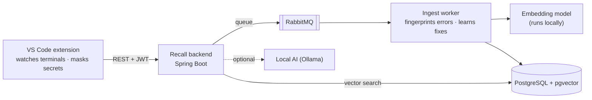

<h1 align="center">Recall</h1>

<p align="center">
  <b>Your team's terminal history, as shared and searchable knowledge.</b><br>
  Ask in plain words, get the one command your teammates used. Hit an error, get the fix they found.
</p>

<p align="center">
  
  
  
  
  
  
  
</p>

<p align="center">
  <a href="#-quick-start">Quick start</a> ·
  <a href="#-step-by-step-installation">Full installation guide</a> ·
  <a href="#-using-recall">Using Recall</a> ·
  <a href="#-troubleshooting">Troubleshooting</a> ·
  <a href="docs/DEMO.md">5-minute demo</a>
</p>

---

## ✨ What Recall does

| | |
|---|---|
| 🔎 **Search by meaning** | Press <kbd>Ctrl</kbd>+<kbd>Alt</kbd>+<kbd>R</kbd>, type *"undo my last commit but keep the changes"*, and get **one** command from your team's history (`git reset --soft HEAD~1`), with who used it and when. |
| 🩹 **Fixes for errors your team already solved** | When a command fails in your terminal, Recall checks whether a teammate hit the same error and offers their fix in a notification. |
| 🧠 **Learns on its own** | Nobody writes anything down. When a command fails and the next one that works fixes it, that command becomes the team's fix for that error. |
| 🔒 **Private and local** | Everything runs in Docker on your computer or a team server. No cloud, no API keys, no internet at runtime. Passwords and tokens are masked before anything leaves VS Code. |
| 🤖 **Optional local AI** | With [Ollama](https://ollama.com) installed, questions nobody on the team has answered get a clearly labelled, unverified AI suggestion. Dangerous suggestions (`rm -rf /`, …) are always blocked. |

<details>
<summary><b>How it works (diagram)</b></summary>



More detail in [docs/ARCHITECTURE.md](docs/ARCHITECTURE.md).
</details>

---

## 📋 Contents

1. [Requirements](#-requirements)
2. [Quick start](#-quick-start) (if you already have Docker, Node.js and VS Code)
3. [Step-by-step installation](#-step-by-step-installation)
4. [Using Recall](#-using-recall)
5. [Sharing Recall with your team](#-sharing-recall-with-your-team)
6. [Optional: local AI with Ollama](#-optional-local-ai-with-ollama)
7. [Stop, restart, update, reset](#-stop-restart-update-reset)
8. [Troubleshooting](#-troubleshooting)
9. [For developers](#-for-developers)
10. [Privacy and security](#-privacy-and-security)

---

## 🧰 Requirements

| What | Version | Why | Check with |
|---|---|---|---|
| **Docker** | Docker Desktop (Windows, macOS) or Docker Engine + Compose plugin (Linux) | Runs the backend, database and queue | `docker compose version` |
| **Node.js** | 20 or newer | Runs the setup scripts and builds the extension | `node -v` |
| **VS Code** | 1.93 or newer | Where Recall lives | `code --version` |
| **Git** | any recent | To get the code (and Git Bash on Windows) | `git --version` |

**Your computer:** 8 GB of RAM is the minimum and 16 GB is comfortable. You also need about **4 GB of free disk space** for the Docker images. The **first** start needs internet to download Docker images, Java libraries and the 90 MB embedding model. After that, Recall runs offline.

> [!NOTE]
> Recall is tested on **Windows 11** (PowerShell and Git Bash terminals). Linux and macOS use exactly the same commands; the CI pipeline is set up to test Linux.

---

## ⚡ Quick start

Use this if Docker, Node.js and VS Code are already installed and **Docker is running**.

<details open>
<summary><b>🐧 🍎 Git Bash (Windows), macOS or Linux</b></summary>

```bash
git clone <repository-url> recall
cd recall
docker compose up -d                     # first time: builds the backend, takes a few minutes
./scripts/seed-demo.sh                   # optional demo team; prints an invite code
cd extension
npm ci
npm run package                          # builds recall.vsix
code --install-extension recall.vsix
```
</details>

<details>
<summary><b>🪟 Windows PowerShell</b></summary>

PowerShell 5 does not understand `&&` or Git Bash paths, so run one command per line:

```powershell
git clone <repository-url> recall
cd recall
docker compose up -d
powershell -ExecutionPolicy Bypass -File scripts\seed-demo.ps1
cd extension
npm ci
npm run package
code --install-extension recall.vsix
```
</details>

Then **reload VS Code**, run **Recall: Sign in** from the Command Palette, and pick *Join a team* with the invite code the seed printed. The status bar (bottom left) turns into **`Recall ●`**. Done: jump to [Using Recall](#-using-recall).

---

## 🪜 Step-by-step installation

### Step 1 · Install the tools

<details>
<summary><b>🪟 Windows</b></summary>

1. **Docker Desktop**: download from [docker.com/products/docker-desktop](https://www.docker.com/products/docker-desktop/) and install it with the default settings (WSL 2 backend). Restart when asked, then **start Docker Desktop** and wait until it says *Engine running*.
2. **Node.js 20 LTS or newer**: download the Windows installer from [nodejs.org](https://nodejs.org/).
3. **Git for Windows**: from [git-scm.com](https://git-scm.com/download/win). It also installs **Git Bash**, the easiest terminal for the commands in this guide.
4. **VS Code**: from [code.visualstudio.com](https://code.visualstudio.com/). During setup, keep *"Add to PATH"* ticked so the `code` command works in terminals.

</details>

<details>
<summary><b>🍎 macOS</b></summary>

1. **Docker Desktop**: [docker.com/products/docker-desktop](https://www.docker.com/products/docker-desktop/) (pick Apple silicon or Intel). Start it and wait for *Engine running*.
2. **Node.js 20+**: [nodejs.org](https://nodejs.org/) or `brew install node`.
3. **Git**: comes with the Xcode command-line tools (`xcode-select --install`) or `brew install git`.
4. **VS Code**: [code.visualstudio.com](https://code.visualstudio.com/). Then open VS Code, press <kbd>Cmd</kbd>+<kbd>Shift</kbd>+<kbd>P</kbd> and run **Shell Command: Install 'code' command in PATH**.

</details>

<details>
<summary><b>🐧 Linux (Ubuntu / Debian)</b></summary>

1. **Docker Engine + Compose plugin**: follow [docs.docker.com/engine/install](https://docs.docker.com/engine/install/). Then let your user run Docker without `sudo` and log out and back in:
   ```bash
   sudo usermod -aG docker $USER
   ```
2. **Node.js 20+**: [nodejs.org](https://nodejs.org/) or your distribution's NodeSource packages.
3. **Git**: `sudo apt install git`.
4. **VS Code**: [code.visualstudio.com](https://code.visualstudio.com/) (the `.deb` package adds the `code` command).

</details>

**Check that everything is there** (in a new terminal):

```bash
docker compose version
node -v
git --version
code --version
```

Each command should print a version. `node -v` must show `v20` or higher.

### Step 2 · Get the code

```bash
git clone <repository-url> recall
cd recall
```

> [!TIP]
> On Windows, put the folder somewhere short like `C:\dev\recall`, **not** inside OneDrive. OneDrive syncing gets in the way of builds and slows everything down.

### Step 3 · Configure (optional)

Recall works out of the box. To change settings, copy the example file and edit it:

```bash
cp .env.example .env          # PowerShell: Copy-Item .env.example .env
```

| Variable | Default | What it does |
|---|---|---|
| `RECALL_JWT_SECRET` | a development value | Signs login tokens. **Set your own random string of 32+ characters before other people use your server.** |
| `POSTGRES_USER` / `POSTGRES_PASSWORD` / `POSTGRES_DB` | `recall` | Database credentials |
| `RABBITMQ_DEFAULT_USER` / `RABBITMQ_DEFAULT_PASS` | `recall` | Message queue credentials |
| `SPRING_PROFILES_ACTIVE` | *(empty)* | Set to `ai` to use a local AI (see [Ollama](#-optional-local-ai-with-ollama)) |
| `RECALL_OLLAMA_URL` | `http://host.docker.internal:11434` | Where Ollama runs |
| `RECALL_OLLAMA_MODEL` | `qwen2.5-coder:7b` | Use `qwen2.5-coder:1.5b` on computers with little free memory |

> [!IMPORTANT]
> `.env` is never committed to Git. Don't put real secrets anywhere else.

### Step 4 · Start the backend

Make sure Docker is running, then, in the `recall` folder:

```bash
docker compose up -d
```

The **first** run builds the backend image. It downloads Java libraries and the embedding model, which takes **3–10 minutes** depending on your internet. Later starts take about 30 seconds.

Check that all three services are **healthy**:

```bash
docker compose ps
```

```
NAME                STATUS
recall-backend-1    Up 40 seconds (healthy)
recall-postgres-1   Up 50 seconds (healthy)
recall-rabbitmq-1   Up 50 seconds (healthy)
```

And ask the backend itself:

```bash
curl http://localhost:8080/api/v1/health
```

```json
{"status":"UP","db":"UP","queue":"UP","embedder":"UP"}
```

> [!NOTE]
> Recall uses ports **8080** (API), **5432** (PostgreSQL), **5672** and **15672** (RabbitMQ). If another program already uses one of them, see [Troubleshooting](#-troubleshooting).

### Step 5 · Load the demo team (recommended)

This creates a team with two fake teammates (**Daksh** and **Priya**), a month of realistic history (200 commands) and 15 errors they fixed, so you can try everything right away.

| Terminal | Command |
|---|---|
| Git Bash / macOS / Linux | `./scripts/seed-demo.sh` |
| PowerShell | `powershell -ExecutionPolicy Bypass -File scripts\seed-demo.ps1` |

You should see:

```
Seeding demo data into http://localhost:8080
Sent 200 commands; 15 error fixes learned.

Team "Recall demo"   invite code: FMX9MH3ACM
  Daksh: daksh@recall.demo / recall-demo-2026
  Priya: priya@recall.demo / recall-demo-2026
In VS Code: "Recall: Sign in" → "Join a team" with the invite code above.
```

**Write down the invite code.** Yours will be different. Running the seed again is safe: it creates nothing twice and prints the same code.

### Step 6 · Install the VS Code extension

Build the extension package and install it:

```bash
cd extension
npm ci
npm run package
code --install-extension recall.vsix
```

You should see `Extension 'recall.vsix' was successfully installed.` Then **reload VS Code**: <kbd>Ctrl</kbd>+<kbd>Shift</kbd>+<kbd>P</kbd> → **Developer: Reload Window**.

<details>
<summary>Other ways to install</summary>

- **From the VS Code window:** open the Extensions view (<kbd>Ctrl</kbd>+<kbd>Shift</kbd>+<kbd>X</kbd>), click the **⋯** menu at the top → **Install from VSIX…** → pick `extension/recall.vsix`.
- **From source, for development:** open the `recall` folder in VS Code and press <kbd>F5</kbd> (*Run Recall extension*). A second VS Code window opens with the extension loaded.
- **From CI:** download the `recall-vsix` artifact of a pipeline run.

</details>

### Step 7 · Sign in

1. Press <kbd>Ctrl</kbd>+<kbd>Shift</kbd>+<kbd>P</kbd> (<kbd>Cmd</kbd>+<kbd>Shift</kbd>+<kbd>P</kbd> on macOS) and run **Recall: Sign in**.
2. Pick one:

   | Option | When |
   |---|---|
   | **Join a team** | You have an invite code (for example from the demo seed). Enter the code, your email, your name as teammates will see it, and a password (8+ characters). |
   | **Create a team** | You are starting a new team. You get an **invite code** to give to your teammates. |
   | **Sign in** | You already have an account. |

3. Look at the status bar in the bottom-left corner:

   | Status bar | Meaning |
   |---|---|
   | `Recall ●` | Connected. Your terminal commands are shared with your team. |
   | `Recall ○` | The backend can't be reached. Commands are queued and sent later. |
   | `Recall ○ (5 queued)` | Offline with 5 commands waiting; nothing is lost. |

   Click it any time for a menu with every Recall action.

### Step 8 · Try it

**Search.** Press <kbd>Ctrl</kbd>+<kbd>Alt</kbd>+<kbd>R</kbd> (<kbd>Cmd</kbd>+<kbd>Alt</kbd>+<kbd>R</kbd>) and type `undo my last commit but keep the changes`. A card shows:

```
From your team
  git reset --soft HEAD~1
  used 4× by Priya, 2 days ago · match 70%
  [ Insert into terminal ]  [ Copy ]  [ Not what I wanted ]
```

**A teammate's fix.** Open a terminal in VS Code (<kbd>Ctrl</kbd>+<kbd>`</kbd>) in any empty folder and run these one at a time:

```bash
git init demo-a
cd demo-a
git switch recall-demo
```

Git fails with `fatal: invalid reference: recall-demo`, and Recall shows a notification:
**"Recall: a teammate fixed this — git switch -c recall-demo"** with **Insert**, **Why?** and **Dismiss**.

**Teach Recall something.** Make a new mistake and fix it yourself; Recall remembers the fix for everyone. The full walkthrough, with what to say at each step, is in **[docs/DEMO.md](docs/DEMO.md)**.

### Step 9 · Check everything (optional)

This runs the whole story against your backend with fresh test accounts and checks every answer:

| Terminal | Command |
|---|---|
| Git Bash / macOS / Linux | `./scripts/e2e.sh` |
| PowerShell | `powershell -ExecutionPolicy Bypass -File scripts\e2e.ps1` |

```
  ok  1  health: status, db, queue and embedder are UP
  ok  2  register creates a team and returns a token and invite code
  …
  ok 15  the team lists both members
E2E PASS
```

---

## 🧑‍💻 Using Recall

### Commands

Open the Command Palette (<kbd>Ctrl</kbd>+<kbd>Shift</kbd>+<kbd>P</kbd>) and type *Recall*:

| Command | Shortcut | What it does |
|---|---|---|
| **Recall: Search…** | <kbd>Ctrl</kbd>+<kbd>Alt</kbd>+<kbd>R</kbd> | Ask in plain words; get one command from your team |
| **Recall: Show last fix** | | Shows the last fix Recall offered, with who fixed it |
| **Recall: Toggle capture** | | Pause or resume sharing your terminal commands |
| **Recall: Sign in** / **Sign out** | | Log in, join or create a team / log out |
| **Recall: Show menu** | click the status bar | All of the above in one menu |
| **Recall: Send queued events now** | | Sends commands that were queued while offline |
| **Recall: Show log** | | What Recall is doing, for troubleshooting |

### The result card

| Button | What happens |
|---|---|
| **Insert into terminal** | Puts the command on your terminal prompt **without running it**; press Enter when you're sure |
| **Copy** | Copies the command |
| **Not what I wanted** | Search again with different words |
| **Didn't work** (fixes only) | Tells your team the fix didn't help; fixes that keep failing stop being offered |

Answers are labelled **From your team** (someone on your team ran it), **Unverified AI suggestion** (from the local AI; check it before running) or **No match**.

### Settings

<kbd>Ctrl</kbd>+<kbd>,</kbd> → search for *Recall*:

| Setting | Default | |
|---|---|---|
| `recall.serverUrl` | `http://localhost:8080` | Your team's Recall backend |
| `recall.enabled` | `true` | Share terminal commands (same as *Toggle capture*) |
| `recall.captureOutput` | `true` | Send the last 8 KB of output of **failed** commands (masked), needed for error fixes |
| `recall.ignorePatterns` | `[]` | Regular expressions; matching commands are **never** sent, e.g. `"^vault "` |
| `recall.redactPatterns` | `[]` | Extra regular expressions to mask as `***`, e.g. `"acme-[0-9]{6}"` |
| `recall.autoFixNotifications` | `true` | Show a notification when a failed command has a known fix |

> [!TIP]
> Start a command with a **space** to keep it out of Recall, the same convention shells use to keep it out of history.

> [!NOTE]
> Recall reads commands through VS Code's **shell integration**, which works in PowerShell, Git Bash, bash, zsh and fish terminals, but **not in `cmd.exe`**. If a terminal has no shell integration, Recall shows a one-time hint.

---

## 👥 Sharing Recall with your team

Recall is most useful when the whole team uses **one** backend.

1. **Pick one computer or server** that stays on and that everyone can reach on the network. Start Recall there (steps 1–4).
2. **Set a real secret** in `.env` on that machine, then restart with `docker compose up -d`:
   ```
   RECALL_JWT_SECRET=<a long random string, 32+ characters>
   ```
3. **Find its address**, e.g. `192.168.1.20`: `ipconfig` on Windows, `ip addr` on Linux, `ipconfig getifaddr en0` on macOS. Allow port **8080** through its firewall (Windows asks the first time).
4. **One person creates the team** (*Recall: Sign in → Create a team*) and shares the **invite code**.
5. **Everyone else** installs the extension (step 6), sets **`recall.serverUrl`** to `http://192.168.1.20:8080`, and runs *Recall: Sign in → Join a team*.

Anyone who joins immediately benefits from the team's history. For example, a teammate who hits an error someone else already fixed gets the fix in their very first session.

> [!WARNING]
> The backend speaks plain HTTP. Use it on a trusted network (office LAN, VPN). For anything wider, put it behind a reverse proxy with HTTPS.

---

## 🤖 Optional: local AI with Ollama

Without AI, a question nobody on the team has answered gets **No match**. With AI, a model **on your own computer** suggests one command, clearly labelled *Unverified AI suggestion*. Nothing is sent to the internet.

1. Install **[Ollama](https://ollama.com/download)** and download a model:
   ```bash
   ollama pull qwen2.5-coder:7b       # needs about 5 GB of free memory
   ollama pull qwen2.5-coder:1.5b     # lighter alternative, about 1.5 GB
   ```
2. In `.env`:
   ```
   SPRING_PROFILES_ACTIVE=ai
   RECALL_OLLAMA_MODEL=qwen2.5-coder:7b     # or qwen2.5-coder:1.5b
   ```
3. Restart the backend: `docker compose up -d`.
4. Try a search nobody on your team has done, e.g. *"count the lines of code in all python files"*.

If Ollama is not running, Recall simply behaves as if there were no AI. Suggestions that could destroy data (wiping disks, `rm -rf /`, fork bombs, shutting down, force-pushing `main`) are **never** shown. The first answer takes a few seconds while the model loads.

---

## 🔁 Stop, restart, update, reset

| I want to… | Command |
|---|---|
| Stop Recall (keep all data) | `docker compose stop` |
| Start it again | `docker compose up -d` |
| See what's running | `docker compose ps` |
| See backend logs | `docker compose logs -f backend` |
| **Update** to a newer version | `git pull`, then `docker compose up -d --build`, then rebuild and reinstall the extension (step 6) |
| Start over with empty data | `docker compose down -v` ⚠️ **deletes all Recall data**, then `docker compose up -d` |
| Remove Recall completely | `docker compose down -v --rmi local`, uninstall the extension, delete the folder |

The RabbitMQ admin page is at **http://localhost:15672** (user `recall`, password `recall` unless you changed them).

---

## 🛠️ Troubleshooting

<details>
<summary><b>PowerShell: <code>The token '&amp;&amp;' is not a valid statement separator</code></b></summary>

Windows PowerShell 5 does not support `&&` and does not know Git Bash paths like `/c/dev/recall`. Either run the commands one per line with Windows paths (`cd C:\dev\recall\extension`, then `npm run package`), or use **Git Bash**, where every command in this guide works as written.
</details>

<details>
<summary><b>PowerShell: <code>running scripts is disabled on this system</code></b></summary>

Windows blocks local scripts by default. Run them like this, which bypasses the policy for that one command only:

```powershell
powershell -ExecutionPolicy Bypass -File scripts\seed-demo.ps1
```
</details>

<details>
<summary><b><code>code: command not found</code> or <code>ENOENT … recall.vsix</code></b></summary>

- `code` not found: on Windows, reinstall VS Code with *Add to PATH*; on macOS, run **Shell Command: Install 'code' command in PATH** in VS Code. Or install from the Extensions view: **⋯ → Install from VSIX…**.
- `ENOENT … recall.vsix`: you are not in the `extension` folder, or `npm run package` has not run. Use the full path: `code --install-extension C:\path\to\recall\extension\recall.vsix`.
</details>

<details>
<summary><b><code>docker compose</code> fails: <em>Cannot connect to the Docker daemon</em> / <em>pipe … dockerDesktopLinuxEngine</em></b></summary>

Docker is not running. Start Docker Desktop and wait for *Engine running* (Linux: `sudo systemctl start docker`), then try again.
</details>

<details>
<summary><b><em>port is already allocated</em> (8080, 5432, 5672 or 15672)</b></summary>

Another program uses that port, often a local PostgreSQL on 5432. Find it:

- Windows (PowerShell): `Get-NetTCPConnection -LocalPort 5432 | Select-Object OwningProcess`, then look up the process in Task Manager.
- macOS / Linux: `lsof -i :5432`

Stop that program, or change the left-hand port in `docker-compose.yml` (for example `"5433:5432"`). If you change **8080**, also set `recall.serverUrl` in VS Code to the new port.
</details>

<details>
<summary><b>The status bar stays <code>Recall ○</code></b></summary>

1. `docker compose ps`: all three services must be *(healthy)*. The backend needs about 30 seconds after starting.
2. `curl http://localhost:8080/api/v1/health` must return `"status":"UP"`. If `db`, `queue` or `embedder` is `DOWN`, check `docker compose logs backend`.
3. In VS Code, check that `recall.serverUrl` points at the right address.
4. Not signed in? Click the status bar → **Sign in…**.
</details>

<details>
<summary><b>No notification when a command fails</b></summary>

- The terminal needs **shell integration**: PowerShell, Git Bash, bash, zsh or fish, not `cmd.exe`. Make sure `terminal.integrated.shellIntegration.enabled` is on (it is by default).
- A notification appears only if someone on your team fixed **that** error before (or the local AI has a suggestion). New errors are silent, but Recall learns from whatever you do next.
- Check `recall.autoFixNotifications` and **Recall: Show log**.
</details>

<details>
<summary><b>Search always says <em>No match</em></b></summary>

Your team has no matching history yet. Load the demo (`./scripts/seed-demo.sh`) or use your terminals for a while. Recall only answers when it's confident; very short questions ("unstage a file") may not reach the threshold.
</details>

<details>
<summary><b>The seed or e2e script says <code>… not healthy after 240 s</code> or <code>SEED FAILED</code></b></summary>

The backend isn't up yet, typically during the first build. Wait until `docker compose ps` shows *(healthy)* and run the script again; it's safe to repeat.
</details>

<details>
<summary><b>The computer becomes slow, or Docker containers get killed</b></summary>

Recall needs about 2 GB of memory (backend 1 GB, database and queue 512 MB each), plus up to 5 GB for the optional 7B AI model. Close heavy programs (browsers with many tabs) or use the smaller `qwen2.5-coder:1.5b` model. **Restarting Docker Desktop** returns memory it keeps after big builds.
</details>

<details>
<summary><b>The first <code>docker compose up</code> fails while downloading</b></summary>

The first build downloads Docker images, Java libraries (Maven Central) and the embedding model (Hugging Face). Check your internet or proxy, then run `docker compose up -d` again; finished steps are cached.
</details>

Still stuck? **Recall: Show log** in VS Code and `docker compose logs backend` usually say exactly what's wrong.

---

## 🧑‍🔬 For developers

<details>
<summary><b>Project layout</b></summary>

```
recall/
├── backend/              Spring Boot app (Java 21, Maven wrapper), Dockerfile, Flyway migrations
│   └── src/main/resources/glossary/commands.tsv   plain-English phrases that help search
├── extension/            VS Code extension (TypeScript, esbuild)
├── scripts/              seed-demo, e2e, load-test, fetch-model (.sh + .ps1; logic in scripts/lib/*.mjs)
├── shared/fixtures/      secret-masking cases used by both the backend and the extension tests
├── docs/                 ARCHITECTURE.md · API.md · DEMO.md · DECISIONS.md
├── docker-compose.yml    PostgreSQL + pgvector, RabbitMQ, backend
└── .github/workflows/    CI: backend verify, extension tests + .vsix, end-to-end
```
</details>

<details>
<summary><b>Backend tests</b> (JUnit 5, Testcontainers, JaCoCo)</summary>

Needs Docker running and a local copy of the embedding model (once):

```bash
./scripts/fetch-model.sh           # PowerShell: powershell -ExecutionPolicy Bypass -File scripts\fetch-model.ps1
cd backend
./mvnw verify                      # PowerShell: .\mvnw.cmd verify
```

`verify` runs the unit tests and the integration tests, including acceptance tests **T1–T10**, against throwaway PostgreSQL and RabbitMQ containers. It fails below 80 % line coverage on the `service` and `domain` packages; the report is written to `backend/target/site/jacoco/index.html`. Java 21 or newer is needed only to run these tests outside Docker.
</details>

<details>
<summary><b>Extension tests</b> (Vitest, @vscode/test-electron)</summary>

```bash
cd extension
npm ci
npm test                                                             # unit tests + tests in a real VS Code
RECALL_LIVE_SERVER=http://localhost:8080 npm run test:integration    # also against your running backend
RECALL_DEMO_INVITE=<invite code> npm run test:integration            # runs docs/DEMO.md step by step
```

The first run downloads a copy of VS Code (about 320 MB) into `extension/.vscode-test/`.
</details>

<details>
<summary><b>Other scripts</b></summary>

| Script | What it does |
|---|---|
| `scripts/load-test.sh [users] [seconds]` | Concurrent users posting events and searching; prints latency percentiles |
| `scripts/fetch-model.sh` | Downloads the pinned embedding model into `backend/models/` (checked by SHA-256) |
| `scripts/e2e.sh` | The end-to-end check from step 9 |
| `scripts/seed-demo.sh` | The demo team from step 5 |

All scripts accept `RECALL_SERVER=http://host:port` to target another backend.
</details>

<details>
<summary><b>Documentation</b></summary>

- [docs/ARCHITECTURE.md](docs/ARCHITECTURE.md): components, data flow, data model
- [docs/API.md](docs/API.md): every HTTP endpoint with `curl` examples
- [docs/DEMO.md](docs/DEMO.md): a 5-minute lab demo script
- [docs/DECISIONS.md](docs/DECISIONS.md): every design decision and deviation from the spec
- [PROGRESS.md](PROGRESS.md): what was built, how it was tested, and what surprised us
</details>

---

## 🔐 Privacy and security

- **Secrets are masked twice**, in VS Code before sending and again on the server: passwords (`--password`, `-pSECRET` for MySQL), tokens, `Authorization` headers, `*_KEY` / `*_TOKEN` / `*_SECRET` / `*PASSWORD*` variables, credentials in URLs, JWTs, AWS keys, SSH keys and more. Add your own with `recall.redactPatterns`.
- **You decide what's shared:** pause with *Toggle capture*, exclude commands with `recall.ignorePatterns`, or start a command with a space.
- **Teams are isolated:** every query is limited to your team, based on your login token. Another team can never see your commands or fixes.
- **Your login** is stored in the operating system's keychain (VS Code SecretStorage), never in settings files.
- **Nothing leaves your network:** the backend, database, embedding model and optional AI all run locally.

---

<p align="center">
  Built as a university team project · Java 21 · Spring Boot · PostgreSQL + pgvector · RabbitMQ · VS Code API<br>
  <sub>License: not yet chosen (all rights reserved). The team will add one.</sub>
</p>
