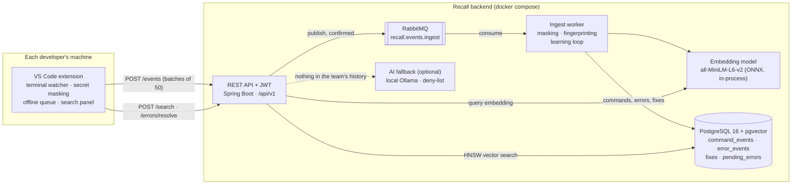
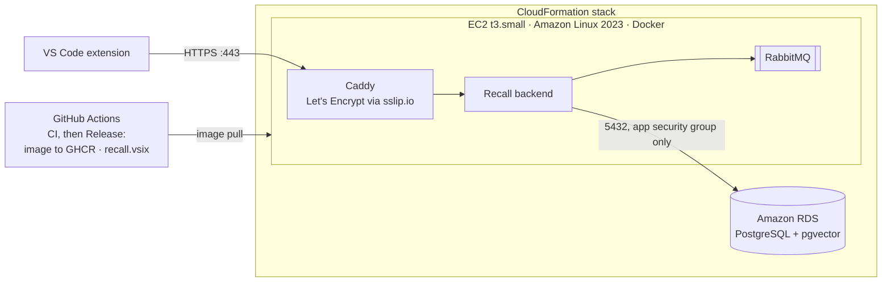
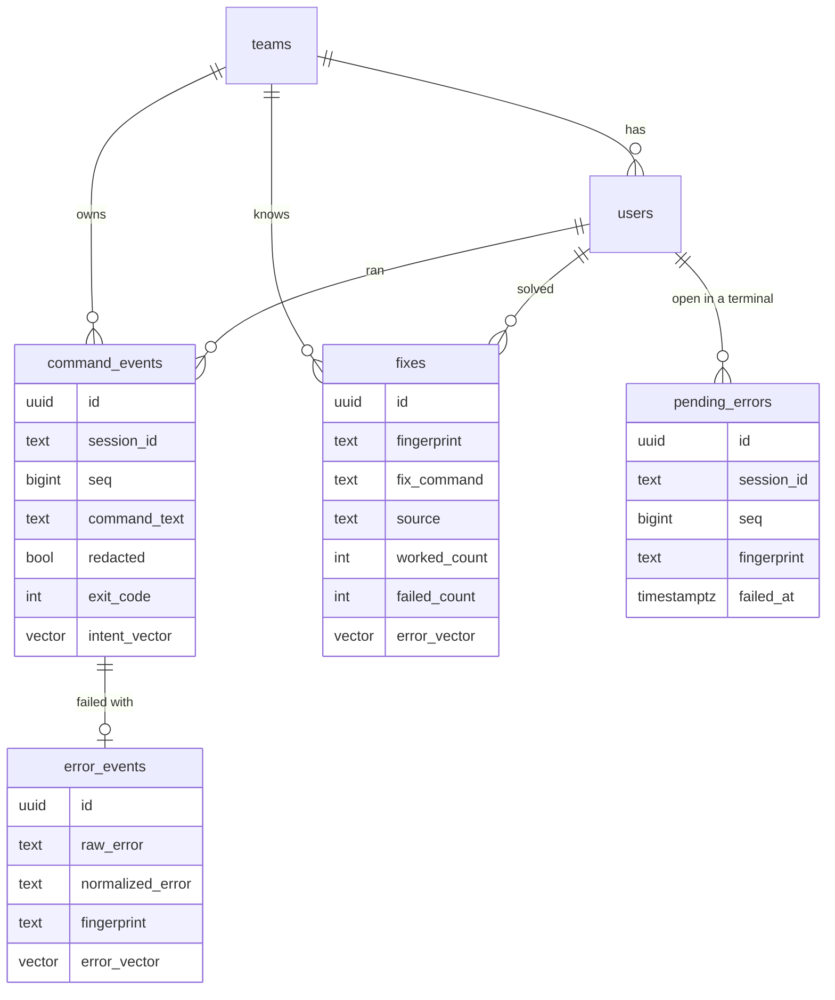

# Architecture

Recall has two parts: a VS Code extension that watches terminals, and a backend that stores the team's history,
answers questions and learns fixes. Everything runs locally in Docker; nothing needs an API key or the internet at
runtime.



## The two paths

**Capture (write path).** The extension listens to VS Code's shell integration. For every finished command it builds
an event (command, exit code, working directory, repo, shell, OS and, for failures, the last 8 KB of output), masks
secrets and appends it to an offline queue kept in VS Code's global state. The queue sends batches of 50 to
`POST /events` with exponential backoff (1 s → 60 s), so nothing is lost while the backend is down.

The API validates the batch, masks it again (old or modified clients cannot leak secrets), stamps it with the team and
user from the JWT, and publishes it to RabbitMQ. It returns 202 only after the broker has confirmed the message. The
ingest worker (a RabbitMQ listener in the same Spring Boot application) stores each event exactly once, keyed by
(user, terminal session, sequence number):

- a successful command that is new for the team gets an **intent vector**: the embedding of the command plus
  plain-English phrases from a curated glossary (`git reset --soft HEAD~1 : undo my last commit but keep the changes`);
- a failed command with output gets an **error fingerprint** (volatile parts such as ports, paths, hashes and times
  replaced by placeholders, then SHA-256) and an embedding of the normalized error;
- the **learning loop** sees every event of the terminal session. A failure opens a pending error; the next command
  that succeeds within 10 minutes and 5 commands, runs the same tool (or is a known "unblocker" such as
  `npx kill-port`), is not trivial and is not the same command, becomes the team's fix for that fingerprint.

Batches the worker cannot process after three attempts go to a dead-letter queue instead of being lost.

**Answer (read path).** `POST /search` embeds the question, finds the nearest commands of the team in pgvector (HNSW,
cosine), groups identical commands and scores them:

```
score = 0.60·cosine + 0.15·min(1, ln(1+uses)/ln(11)) + 0.15·exp(-age_days/30) + 0.10·(same repo or cwd)
```

The best command is returned if its score is at least 0.55; otherwise the AI fallback is asked; otherwise the answer
is `NONE`. `POST /errors/resolve` fingerprints the error: the team's best fix for that exact fingerprint wins
(most successes minus twice the failures); else the fix of an error at least 0.80 similar; else the AI; else `NONE`.
Every team answer carries provenance: who, when, how many times.

The **AI fallback** is a local Ollama model, used only with the `ai` profile. It gets the masked command and error
output, answers with one command line, and every suggestion passes a deny-list (disk wipes, `rm -rf /`, fork bombs,
shutdown, force-pushing protected branches) before anyone sees it. If Ollama is missing or slow, Recall answers as if
there were no AI.

## Isolation and privacy

- The team id comes only from the JWT. Every query filters on it; a team id in a request body is ignored. Feedback on
  another team's fix is 403.
- Secrets are masked twice with the same rules (a shared fixture of 31 command lines tests both implementations).
  Commands that start with a space, or match `recall.ignorePatterns`, never leave the machine.
- The JWT lives in VS Code's SecretStorage (the OS keychain), never in settings.

## Deployment on AWS

The same backend runs on AWS from one CloudFormation template, [`deploy/aws/recall.yaml`](../deploy/aws/recall.yaml),
built for the AWS Academy sandbox (t3.small, us-east-1, everything deleted when a session ends). Step-by-step guide:
[DEPLOY_AWS.md](DEPLOY_AWS.md).



- **Resources:** an app security group (443, 80, 22 in), a DB security group (5432 only from the app group), an RDS
  instance (db.t3.micro, not public, no backups) and the EC2 instance. `DatabaseMode=container` runs PostgreSQL on the
  instance instead of RDS.
- **Boot:** user data writes `/etc/recall.env`, clones the repository and runs `deploy/aws/setup.sh`: Docker, 2 GB swap,
  pull the prebuilt image (or build from source if the pull fails), start `deploy/aws/docker-compose.yml`, seed the demo
  team, write the landing page, wait for HTTPS. `cfn-signal` reports the result, so the stack is CREATE_COMPLETE only
  once `/health` is UP.
- **Secrets:** the database password is the stack's own UUID (the database is reachable only from the app instance); the
  JWT secret is generated on the instance with `openssl rand`.

## Components

| Part | Where | Notes |
|---|---|---|
| Extension | `extension/src` | `watcher.ts` (shell integration), `events.ts` + `masking.ts`, `queue.ts`, `search.ts` + `panel*.ts`, `fixes.ts` |
| REST API | `backend/.../web` | controllers, RFC 7807 errors, rate limit on `/events` (100/min/user) |
| Security | `backend/.../security` | Spring Security resource server, HS256 JWT, BCrypt |
| Ingest worker | `backend/.../messaging`, `service/EventStore` | RabbitMQ listener, retries, dead-letter queue |
| Embeddings | `backend/.../service/embedding` | ONNX Runtime + WordPiece tokenizer; hashing embedder for tests/offline |
| Search | `backend/.../service/search` | ranking formula, all weights in `recall.ranking.*` |
| Errors and learning | `backend/.../service/errors`, `service/learning` | fingerprinting, resolution, learning loop, feedback |
| AI | `backend/.../service/ai` | Ollama client, no-op default, deny-list |
| Database | `backend/src/main/resources/db/migration` | Flyway V1–V5 |

## Data model



Indexes: HNSW (cosine) on every vector column, `(team_id, fingerprint)`, `(team_id, created_at)`, and
`(team_id, md5(command_text))` for usage counts.

## Tests

- Backend: JUnit 5 unit tests for every service; integration tests over real HTTP against Testcontainers (pgvector and
  RabbitMQ), including the acceptance tests T1–T10. JaCoCo fails the build below 80 % line coverage on `service` and
  `domain`.
- Extension: Vitest unit tests; `@vscode/test-electron` tests that drive real VS Code terminals.
- `scripts/e2e.sh`: the whole story against the running docker-compose stack.
