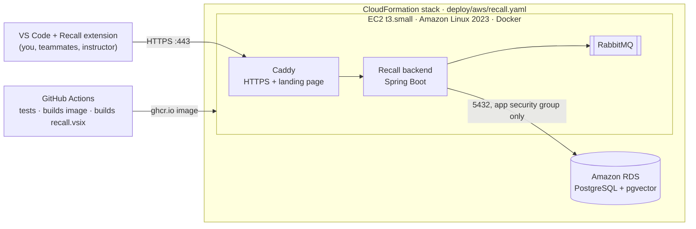

# Deploying Recall on AWS (AWS Academy sandbox)

One CloudFormation template builds the whole system in your AWS Academy sandbox: upload a file, click **Submit**, wait
about 20 minutes, open a URL. It is built for the *AWS Academy Cloud Developing* sandbox rules (us-east-1, t2/t3
small instances, RDS PostgreSQL allowed, `vockey`, `LabInstanceProfile`).



> **The sandbox deletes everything when the session timer reaches 0:00.** That is why the whole setup is one
> template: each session you create the stack again, and it comes back with the demo data already loaded. Real team
> data does not survive between sessions.

## Contents

1. [One-time setup](#1-one-time-setup-10-minutes) (10 minutes, once)
2. [Every session: create the stack](#2-every-session-create-the-stack-3-clicks-20-minutes-waiting) (3 clicks, 20 minutes of waiting)
3. [Connect VS Code](#3-connect-vs-code-2-minutes) (2 minutes)
4. [Demo for the instructor](#4-demo-for-the-instructor-10-minutes) (10 minutes)
5. [Connect teammates](#5-connect-teammates)
6. [Troubleshooting](#6-troubleshooting)
7. [What the template creates, and cost](#7-what-the-template-creates-and-cost)

---

## 1. One-time setup (10 minutes)

### 1.1 Let GitHub build everything

Every push to `main` runs **CI** (all tests) and then **Release**, which publishes:

- the backend image `ghcr.io/bhargavchetanya/recall-backend:latest`, which the server downloads instead of compiling;
- `recall.vsix`, the VS Code extension, on the repository's
  [Releases page](https://github.com/bhargavchetanya/Recall-cloud-/releases/latest).

Check both workflows are green under the repository's **Actions** tab.

### 1.2 Check the image is public

The server downloads the image without logging in to GitHub, so it must be public. It is published from a public
repository, so it already is. If you ever make the repository private: GitHub → your profile → **Packages** →
**recall-backend** → **Package settings** → **Change visibility** → **Public**. Without that, deployment still works,
but the server compiles the backend itself and the stack takes about 15 minutes longer.

### 1.3 Install the extension in your VS Code

Download `recall.vsix` from the [Releases page](https://github.com/bhargavchetanya/Recall-cloud-/releases/latest).
In VS Code: **Extensions** panel → **⋯** (top of the panel) → **Install from VSIX…** → choose `recall.vsix` →
reload when asked.

### 1.4 Have the template file at hand

It is `deploy/aws/recall.yaml` in your copy of this repository. Or download it:
[recall.yaml](https://raw.githubusercontent.com/bhargavchetanya/Recall-cloud-/main/deploy/aws/recall.yaml)
→ **Cmd+S** / **Ctrl+S** → save as `recall.yaml`.

---

## 2. Every session: create the stack (3 clicks, 20 minutes waiting)

### 2.1 Start the lab

1. Canvas → **AWS Academy Cloud Developing** → **Modules** → **Sandbox**.
2. **Start Lab**. Wait until the dot next to **AWS** is **green**.
3. Click **AWS** to open the AWS Console. Check the region at the top right is **N. Virginia (us-east-1)**.

> If the lab page says **"Please login again"**, your browser is blocking cross-site cookies. Use Chrome, or in
> Safari turn off *Settings → Privacy → Prevent cross-site tracking*. Open the lab only from Canvas.

### 2.2 Create the stack

1. In the console search bar type **CloudFormation** → open it.
2. **Create stack** → **With new resources (standard)**.
3. **Choose an existing template** → **Upload a template file** → **Choose file** → `recall.yaml` → **Next**.
4. **Stack name**: `recall`. Leave every parameter as it is → **Next**.
5. **Configure stack options**: change nothing → **Next**.
6. **Review** → **Submit**.

### 2.3 Wait for CREATE_COMPLETE

The stack shows **CREATE_IN_PROGRESS**. It takes about **20 minutes**: RDS needs about 10, then the server installs
Docker, downloads Recall, starts it, loads the demo data and gets the HTTPS certificate. The stack turns
**CREATE_COMPLETE** only once Recall actually answers, so when it is green, it works.

Watch it in the **Events** tab. While you wait, click **Start Lab** once more so the 4-hour timer restarts.

### 2.4 Open Recall

**Outputs** tab → click **RecallUrl** (for example `https://3-91-20-7.sslip.io`). The landing page shows the server
URL, the demo team's invite code and the demo accounts.

---

## 3. Connect VS Code (2 minutes)

1. Command Palette (**Cmd+Shift+P** / **Ctrl+Shift+P**) → **Recall: Set server URL** → paste the **RecallUrl** →
   Enter. Recall checks the connection; the status bar (bottom left) shows **`Recall ●`**.
2. Click **Sign in** in the notification (or Command Palette → **Recall: Sign in**) → **Sign in** →
   `daksh@recall.demo` / `recall-demo-2026`.
3. Press **Cmd+Alt+R** (macOS) or **Ctrl+Alt+R** (Windows/Linux) and type
   *undo my last commit but keep the changes*.

The URL is new every session, so repeat step 1 each time; signing in again is needed too, because the server is new.

---

## 4. Demo for the instructor (10 minutes)

**Before the demo (25 minutes ahead):** start the lab, create the stack (section 2), click **Start Lab** again
while it builds, then connect VS Code (section 3). Keep these tabs open: CloudFormation (the stack), EC2, RDS,
the landing page, and the repository's GitHub Actions page.

| # | Show | Where | Cloud idea it demonstrates |
|---|---|---|---|
| 1 | The stack's **Resources** tab: security groups, RDS instance, EC2 instance, all from one file | CloudFormation | Infrastructure as Code |
| 2 | The template itself (`deploy/aws/recall.yaml`), parameters such as `DatabaseMode` | GitHub / editor | Repeatable, parameterised deployments |
| 3 | The RDS database: engine PostgreSQL, not publicly accessible | RDS → Databases | Managed services |
| 4 | Security groups: app allows 80/443 (and 22); the database allows 5432 **only from the app's security group** | EC2 → Security Groups | Network isolation, least privilege |
| 5 | **Actions** tab: CI runs the tests, Release builds the image and `recall.vsix` | GitHub | CI/CD, container registry |
| 6 | The landing page and `/api/v1/health` (`db`, `queue`, `embedder` all UP) | Browser | Health checks |
| 7 | **Search by meaning**: Cmd/Ctrl+Alt+R → *undo my last commit but keep the changes* → `git reset --soft HEAD~1`, with who used it and when | VS Code | The product |
| 8 | **Learned fix**: in VS Code's terminal, inside any git repository, run `git switch recall-demo`. It fails, and Recall offers the fix a teammate found for exactly that error | VS Code | The product |
| 9 | **Team isolation**: Command Palette → **Recall: Sign out** → **Sign in** → **Create a team** → search again: nothing from the demo team is visible | VS Code | Multi-tenancy |
| 10 | **Resilience**: stop the backend (below), run a few commands (status bar shows them queued), start it again, they arrive | EC2 Session Manager + VS Code | Asynchronous messaging, fault tolerance |

**Stopping and starting the backend for step 10.** EC2 → Instances → `recall-server` → **Connect** →
**Session Manager** → **Connect** (a terminal opens in the browser; no SSH key needed). Then:

```bash
sudo docker compose -f /opt/recall/deploy/aws/docker-compose.yml stop backend
```

```bash
sudo docker compose -f /opt/recall/deploy/aws/docker-compose.yml start backend
```

Show the running containers with:

```bash
sudo docker compose -f /opt/recall/deploy/aws/docker-compose.yml ps
```

---

## 5. Connect teammates

Each teammate needs only VS Code:

1. Install `recall.vsix` from the [Releases page](https://github.com/bhargavchetanya/Recall-cloud-/releases/latest)
   (Extensions → **⋯** → **Install from VSIX…**). Once.
2. Each session: **Recall: Set server URL** → the RecallUrl you send them.
3. **Recall: Sign in** → **Join a team** with the invite code on the landing page (or sign in with a demo account).

Remember the limits of the sandbox: the server exists only while your session runs, and its data is deleted when the
session ends. While it is down, teammates' commands queue on their laptops and are sent to whichever server they point
at next.

---

## 6. Troubleshooting

| Problem | What to do |
|---|---|
| Stack goes to **ROLLBACK_IN_PROGRESS** | Open **Events** and find the first red **CREATE_FAILED** line; its reason says what failed. Delete the stack and create it again. To keep the server for debugging, choose **Preserve successfully provisioned resources** under *Stack failure options* on the **Configure stack options** page. |
| Failure on **Database** | Create the stack again with **DatabaseMode** = `container` (PostgreSQL runs on the server instead of RDS). |
| Failure on **AppServer** with "instance type" | Create it again with **InstanceType** = `t2.small`. |
| Failure on **AppServer**: "Failed to receive 1 resource signal" | The setup script failed or ran out of time. With preserved resources: EC2 → `recall-server` → **Actions** → **Monitor and troubleshoot** → **Get system log**, or Session Manager → `sudo tail -100 /var/log/recall-setup.log`. |
| Stack took about 35 minutes | The image could not be downloaded, so the server compiled it. Check the package is public (1.2). |
| RecallUrl does not open but the stack is complete | Use **HttpFallbackUrl** (plain HTTP on the IP) in the browser and in **Recall: Set server URL**. The HTTPS certificate may still be on its way; the landing page says so. |
| VS Code shows `Recall ○` | Is the lab still running? Did you run **Recall: Set server URL** with this session's URL? |
| VS Code says *not signed in* or requests fail with 401 | The server is new each session: **Recall: Sign in** again. |
| The lab page says *Please login again* | See the note in 2.1. |

---

## 7. What the template creates, and cost

| Resource | Details |
|---|---|
| `AppSecurityGroup` | 443 and 80 from anywhere; 22 from `SshCidr` (default anywhere; narrow it to `your.ip/32` if you can) |
| `DbSecurityGroup` | 5432 only from `AppSecurityGroup` |
| `Database` | RDS PostgreSQL, db.t3.micro, 20 GB gp2, single-AZ, not public, no backups (the sandbox is wiped anyway) |
| `AppServer` | EC2 t3.small, Amazon Linux 2023, 20 GB gp3, `vockey`, `LabInstanceProfile` (for Session Manager) |

At boot, the server runs [`deploy/aws/setup.sh`](../deploy/aws/setup.sh): installs Docker, adds 2 GB swap, pulls the
backend image, starts [`docker-compose.yml`](../deploy/aws/docker-compose.yml) (backend, RabbitMQ, Caddy), loads the
demo data, writes the landing page and waits for HTTPS. Secrets are never typed by anyone: the database password is the
stack's own UUID, and the login-token secret is generated on the server.

**Parameters** (all have working defaults): `DatabaseMode` (`rds` or `container`), `LoadDemoData`, `InstanceType`
(`t3.small` or `t2.small`), `KeyName` (`vockey`), `InstanceProfile` (`LabInstanceProfile`), `SshCidr`, `GitRepo`,
`GitBranch`, `BackendImage`.

**Cost** against the sandbox budget, roughly: t3.small about $0.02/hour, db.t3.micro about $0.02/hour, plus a little
for storage and the public IP. A 4-hour session costs well under $0.50. Check the remaining budget at the top of the lab
page; if it runs out, the sandbox is disabled.

**Not included on purpose:** the Ollama AI fallback (needs far more memory than the sandbox allows) and automatic
deploys from GitHub (sandbox credentials expire every session).
