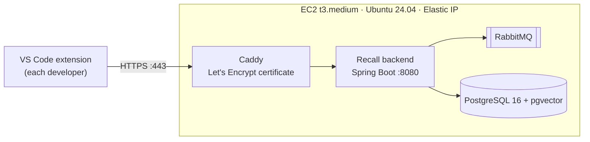

# Deploying Recall on AWS (AWS Academy Learner Lab)

This puts the whole Recall backend (API, ingest worker, PostgreSQL + pgvector, RabbitMQ) on one EC2 instance, behind
Caddy for HTTPS. Teammates point their VS Code extension at the instance's URL.



Only ports 22 (SSH, your IP only), 80 and 443 are open. PostgreSQL, RabbitMQ and the backend have no public ports.

| File | What it does |
|---|---|
| [`deploy/aws/docker-compose.prod.yml`](../deploy/aws/docker-compose.prod.yml) | Production overrides: removes public ports, requires real secrets, adds Caddy |
| [`deploy/aws/Caddyfile`](../deploy/aws/Caddyfile) | HTTPS reverse proxy to the backend |
| [`deploy/aws/bootstrap.sh`](../deploy/aws/bootstrap.sh) | One-time server setup: Docker, swap, then `deploy.sh` |
| [`deploy/aws/deploy.sh`](../deploy/aws/deploy.sh) | Creates `.env` with random secrets, works out the URL, builds and starts everything |

> Learner Lab limits differ a little between courses. If a step below is blocked in your lab, check the lab's
> README (the "Readme" button on the lab page) for the allowed regions and instance types.

## 1. Start the lab

1. Open your AWS Academy course → **Modules** → **Learner Lab** → **Start Lab**. Wait until the dot next to "AWS" is green.
2. Click **AWS Details** → **Download PEM**. This saves `labsuser.pem`, the private key for the `vockey` key pair.
   On macOS/Linux, protect it:
   ```bash
   chmod 400 ~/Downloads/labsuser.pem
   ```
3. Click **AWS** (the green dot) to open the console. Stay in the region the lab opens in (usually **us-east-1**).

## 2. Launch the EC2 instance

EC2 → **Launch instance**:

| Setting | Value |
|---|---|
| Name | `recall` |
| AMI | **Ubuntu Server 24.04 LTS** (64-bit x86) |
| Instance type | **t3.medium** (2 vCPU, 4 GB). Smaller types run out of memory. |
| Key pair | **vockey** |
| Network → security group | Create one named `recall-sg` with three inbound rules: **SSH 22** from *My IP*, **HTTP 80** from *Anywhere*, **HTTPS 443** from *Anywhere* |
| Storage | **20 GiB** gp3 |

Click **Launch instance**.

## 3. Give it a fixed address (Elastic IP)

Without this, the instance gets a new public IP every lab session and the URL changes.

EC2 → **Elastic IPs** → **Allocate Elastic IP address** → **Allocate**. Then **Actions → Associate Elastic IP
address** → choose the `recall` instance → **Associate**. Note the address, e.g. `3.91.20.7`.

## 4. Install and start Recall

From your laptop (use your Elastic IP):

```bash
ssh -i ~/Downloads/labsuser.pem ubuntu@3.91.20.7
```

On the instance:

```bash
git clone https://github.com/bhargavchetanya/Recall-cloud-.git recall
```

```bash
cd recall && sudo ./deploy/aws/bootstrap.sh
```

The first run installs Docker and builds the backend image, which takes about 5–10 minutes. It ends with:

```
Recall is up: https://3-91-20-7.sslip.io
Set recall.serverUrl to https://3-91-20-7.sslip.io in VS Code.
```

[sslip.io](https://sslip.io) is a free DNS service: `3-91-20-7.sslip.io` resolves to `3.91.20.7`, so Caddy can get a
real Let's Encrypt certificate without you buying a domain.

Check it in a browser: `https://3-91-20-7.sslip.io/api/v1/health` should show `"status":"UP"`.

## 5. Load the demo data (optional)

From your laptop, in the repository folder:

```bash
RECALL_SERVER=https://3-91-20-7.sslip.io ./scripts/seed-demo.sh
```

## 6. Connect VS Code

In VS Code: **Settings** → search `recall.serverUrl` → set it to your URL (e.g. `https://3-91-20-7.sslip.io`).
Then run **Recall: Sign In** and create a team. Teammates join with the team's invite code.

## Every new lab session

When a Learner Lab session ends, AWS stops the instance. When you **Start Lab** again, it starts again, and Docker
brings Recall back by itself (all containers use `restart: unless-stopped`). Give it a minute or two, then open the
health URL. The Elastic IP keeps the URL the same.

If the instance did not start, start it from EC2 → Instances → **Instance state → Start**.

## Updating to the latest code

```bash
ssh -i ~/Downloads/labsuser.pem ubuntu@3.91.20.7
```

```bash
cd recall && sudo ./deploy/aws/deploy.sh --pull
```

## Useful commands on the server

```bash
cd ~/recall && sudo docker compose -f docker-compose.yml -f deploy/aws/docker-compose.prod.yml ps
```

```bash
cd ~/recall && sudo docker compose -f docker-compose.yml -f deploy/aws/docker-compose.prod.yml logs -f --tail=100 backend caddy
```

The generated passwords and JWT secret are in `~/recall/.env` (readable only by root). Keep that file: deleting it and
re-running `deploy.sh` makes new passwords that no longer match the existing database.

## Troubleshooting

| Problem | Fix |
|---|---|
| `deploy.sh` waits and then says Recall did not answer | Look at `logs caddy`. If the certificate could not be issued (port 80/443 closed, or Let's Encrypt rate limits on sslip.io), switch to plain HTTP: `sudo RECALL_SITE=:80 ./deploy/aws/deploy.sh`, then use `http://<elastic-ip>` as `recall.serverUrl`. |
| SSH times out | The security group's SSH rule allows only the IP you had when you created it. Edit the rule and choose *My IP* again. |
| Build killed / out of memory | Make sure the instance is t3.medium or larger. `bootstrap.sh` adds 2 GB swap; check with `swapon --show`. |
| URL changed after a new session | You skipped the Elastic IP. Associate one (step 3), then re-run `sudo ./deploy/aws/deploy.sh`; it picks up the new IP. |
| Extension shows `Recall ○` | Check `recall.serverUrl` has no trailing path, and the health URL opens in a browser. |

## Cost

Learner Lab gives a fixed credit budget and never charges your card. Roughly (us-east-1, on-demand):

- t3.medium: about $0.04 per hour, only while the lab session is running.
- 20 GiB gp3 storage: about $1.60 per month.
- Elastic IP: about $0.005 per hour (AWS charges for every public IPv4 address).

A semester of normal use costs well under $20 of lab credit. When the project is graded, release the Elastic IP and
terminate the instance to stop using credit.

## Not included on purpose

- **The Ollama AI fallback.** It needs far more memory or a GPU. Without it, questions nobody answered get `NONE`.
- **Automatic deploys from GitHub Actions.** Learner Lab credentials expire every session, so storing them in GitHub
  does not work; deploy with `deploy.sh --pull` instead.
