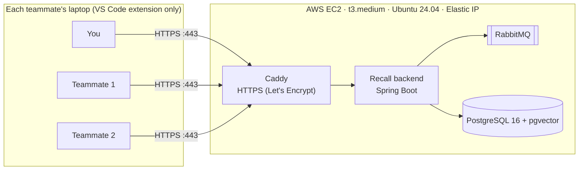

# Deploying Recall on AWS (AWS Academy Learner Lab)

The complete roadmap: set up the server once, connect your team, and keep it running across 4-hour lab sessions.



**Who does what**

| Who | Needs | Does |
|---|---|---|
| **You (server owner)** | AWS Academy Learner Lab, a laptop with Git, Node.js 20+ and VS Code | Sets up the server once, starts the lab for each session, shares the extension |
| **Teammates** | Only VS Code | Install the extension, set the URL, join the team. No Docker, AWS or code needed. |

**Roadmap at a glance**

| Phase | What | Who | Time |
|---|---|---|---|
| [0](#phase-0--before-you-start) | Check you have everything | You | 5 min |
| [1](#phase-1--set-up-the-server-once) | Create the server and start Recall | You, once | 30–40 min |
| [2](#phase-2--set-up-your-own-vs-code-and-create-the-team) | Build the extension and create the team | You, once | 10 min |
| [3](#phase-3--connect-each-teammate) | Connect each teammate | Each teammate, once | 3 min |
| [4](#phase-4--every-lab-session) | Start, extend and resume sessions | You, every session | 3 min |
| [5](#phase-5--updating-to-new-code) | Deploy new code | You, when code changes | 5 min |
| [6](#phase-6--demo-day-checklist) | Demo day checklist | Everyone | 30 min before |
| [7](#phase-7--end-of-the-course) | End of the course | You | 10 min |

> Learner Lab rules (regions, allowed instance types, budget) can differ a little between courses. If a step is
> blocked, open the **Readme** button on your lab page.

---

## Phase 0 — Before you start

- [ ] **You have a Learner Lab.** In Canvas → your AWS Academy course → **Modules**, there is an item called
      **Learner Lab** (or "Sandbox Environment"). The guided labs inside *Cloud Foundations* or *Cloud Developing*
      delete everything when they end, so they cannot host Recall. No Learner Lab? Ask your instructor for
      "AWS Academy Learner Lab" access.
- [ ] **Your laptop has** Git, Node.js 20+ (`node -v`) and VS Code 1.93+ (`code --version`).
- [ ] **You have a copy of this repository** on your laptop:
      ```bash
      git clone https://github.com/bhargavchetanya/Recall-cloud-.git recall
      ```
- [ ] **You know your lab budget.** The lab page shows "Used $X of $Y". See [Cost](#cost-and-how-many-sessions).

---

## Phase 1 — Set up the server (once)

### Step 1.1 · Start the lab and get the key

1. AWS Academy → your course → **Modules** → **Learner Lab** → **Start Lab**.
2. Wait until the dot next to **AWS** turns **green** (1–3 minutes).
3. Click **AWS Details** → **Download PEM**. This saves `labsuser.pem`, the key that lets you log in to the server.
4. **macOS / Linux**: protect the key, or SSH refuses to use it:
   ```bash
   chmod 400 ~/Downloads/labsuser.pem
   ```
   **Windows**: keep it in `Downloads`; if SSH later says the key's permissions are too open, run in PowerShell:
   ```powershell
   icacls $env:USERPROFILE\Downloads\labsuser.pem /inheritance:r /grant:r "$($env:USERNAME):(R)"
   ```
5. Click the green **AWS** dot. The AWS Console opens. Note the region at the top right (usually
   **N. Virginia, us-east-1**) and stay in it for every step.

### Step 1.2 · Launch the EC2 instance

Search **EC2** in the console → **Launch instance**, and fill in:

| Field | Value | Why |
|---|---|---|
| **Name** | `recall` | So you can find it |
| **Application and OS Images** | **Ubuntu** → **Ubuntu Server 24.04 LTS**, 64-bit (x86) | What the setup script expects |
| **Instance type** | **t3.medium** (2 vCPU, 4 GB) | Smaller types run out of memory |
| **Key pair** | **vockey** | Matches `labsuser.pem` |
| **Network settings** → **Edit** → **Create security group** | Name: `recall-sg` | The firewall |
| Inbound rule 1 | **SSH**, port 22, source **My IP** | Only you can log in |
| **Add security group rule** | **HTTP**, port 80, source **Anywhere** | Needed to get the HTTPS certificate |
| **Add security group rule** | **HTTPS**, port 443, source **Anywhere** | How teammates reach Recall |
| **Configure storage** | **20** GiB, **gp3** | Room for Docker images and data |

Click **Launch instance** → **View all instances**. Wait until **Instance state** is **Running** and
**Status check** shows **2/2 checks passed** (2–3 minutes).

### Step 1.3 · Give it a fixed address (Elastic IP)

Without this, the server gets a new IP every session and the URL changes for everyone.

1. EC2 left menu → **Network & Security** → **Elastic IPs** → **Allocate Elastic IP address** → **Allocate**.
2. Select the new address → **Actions** → **Associate Elastic IP address**.
3. **Resource type**: Instance · **Instance**: `recall` → **Associate**.
4. **Write the IP down**, e.g. `3.91.20.7`. Every example below uses this; replace it with yours.

### Step 1.4 · Log in to the server

On your laptop (Terminal on macOS, PowerShell on Windows):

```bash
ssh -i ~/Downloads/labsuser.pem ubuntu@3.91.20.7
```

Type `yes` the first time. You are in when the prompt looks like `ubuntu@ip-172-31-...:~$`.

### Step 1.5 · Install and start Recall

On the server:

```bash
git clone https://github.com/bhargavchetanya/Recall-cloud-.git recall
```

```bash
cd recall && sudo ./deploy/aws/bootstrap.sh
```

What it does (5–10 minutes the first time):

1. Installs Docker and Docker Compose.
2. Adds 2 GB of swap so the build does not run out of memory.
3. Creates `.env` with random database, RabbitMQ and login-token secrets.
4. Builds the backend and starts PostgreSQL, RabbitMQ, the backend and Caddy.
5. Gets an HTTPS certificate for `3-91-20-7.sslip.io` and waits until Recall answers.

It ends with:

```
Recall is up: https://3-91-20-7.sslip.io
Set recall.serverUrl to https://3-91-20-7.sslip.io in VS Code.
```

**This URL is your server address.** [sslip.io](https://sslip.io) is a free DNS service: `3-91-20-7.sslip.io` points
to `3.91.20.7`, so you get real HTTPS without buying a domain.

### Step 1.6 · Check it

Open `https://3-91-20-7.sslip.io/api/v1/health` in a browser. You should see `"status":"UP"`.

Type `exit` to leave the server.

### Step 1.7 · Load demo data (optional)

On your laptop, in the repository folder. It creates a demo team with realistic history and prints its invite code.

macOS / Linux / Git Bash:
```bash
RECALL_SERVER=https://3-91-20-7.sslip.io ./scripts/seed-demo.sh
```

Windows PowerShell:
```powershell
$env:RECALL_SERVER="https://3-91-20-7.sslip.io"; powershell -ExecutionPolicy Bypass -File scripts\seed-demo.ps1
```

---

## Phase 2 — Set up your own VS Code and create the team

### Step 2.1 · Build the extension file

On your laptop:

```bash
cd extension && npm ci && npm run package
```

This creates **`extension/recall.vsix`**, the file every teammate installs.

### Step 2.2 · Install it

VS Code → **Extensions** panel → **⋯** (top of the panel) → **Install from VSIX…** → choose `recall.vsix` →
reload VS Code when asked.

### Step 2.3 · Point it at the server

**Settings** (Ctrl+, / Cmd+,) → search `recall.serverUrl` → enter `https://3-91-20-7.sslip.io`
(no trailing slash or path).

### Step 2.4 · Create the team

Command Palette (Ctrl+Shift+P / Cmd+Shift+P) → **Recall: Sign in** → **Create a team** → enter a team name, your
email, display name and password. Recall shows the **invite code**; click **Copy invite code**.

The bottom-left of VS Code now shows **`Recall ●`**.

### Step 2.5 · Share with your teammates

Send them three things:

1. `recall.vsix`
2. The server URL, e.g. `https://3-91-20-7.sslip.io`
3. The invite code

---

## Phase 3 — Connect each teammate

Each teammate does this once, in about 3 minutes. They need only VS Code.

1. **Install**: Extensions → **⋯** → **Install from VSIX…** → `recall.vsix` → reload.
2. **Server**: Settings → `recall.serverUrl` → paste the URL.
3. **Join**: Command Palette → **Recall: Sign in** → **Join a team** → invite code, email, name, password.
4. **Check**: bottom-left shows **`Recall ●`**. `Recall ○` means the server is not reachable; see
   [Troubleshooting](#troubleshooting).

**Using it:**

| Action | How |
|---|---|
| Record commands | Nothing to do: run commands in VS Code's terminal as usual |
| Search the team's commands | **Ctrl+Alt+R** (Windows/Linux) or **Cmd+Alt+R** (macOS), then type in plain words |
| Get a teammate's fix | Run a failing command; if the team solved that error before, a notification offers the fix |
| Keep a command private | Start it with a space, or add a pattern to `recall.ignorePatterns` |

Passwords and tokens in commands are masked before anything leaves the laptop.

**Important:** the server runs only while **your** lab session is running, because the lab belongs to your account.
When it is off, teammates' commands wait in a queue on their laptops and upload automatically when it is back.
Nothing is lost, but search and fixes do not work in the meantime. Tell the team when you start a session.

Another team can use the same server: one of them picks **Create a team** and shares their own invite code. Teams
never see each other's commands or fixes.

---

## Phase 4 — Every lab session

### Starting a session (about 3 minutes)

1. AWS Academy → Learner Lab → **Start Lab**. Wait for the green dot.
2. Wait about 2 minutes. The EC2 instance starts, and Docker restarts every part of Recall by itself.
3. Open `https://3-91-20-7.sslip.io/api/v1/health` and check for `"status":"UP"`.
4. Tell your teammates it is live.

No SSH and no commands. The Elastic IP keeps the URL the same.

**If the health check is not UP after 3 minutes:** EC2 → **Instances** → `recall` → **Instance state** → **Start**.
Wait 2 minutes and check again.

### During a session: the 4-hour timer

The lab page shows the time left. **Click Start Lab again before it reaches 0** to reset it to 4 hours. There is no
limit on how often you do this.

### When the session ends

When the timer reaches 0, AWS **stops** the instance:

- **Nothing is deleted.** Teams, commands and fixes stay on the server's disk.
- The URL does not change.
- To bring it back, follow [Starting a session](#starting-a-session-about-3-minutes) again.

You can start as many sessions as you like until the course ends. What limits you is the credit budget, below.

---

## Phase 5 — Updating to new code

1. Push the change to GitHub from your laptop.
2. Start the lab if it is not running, then:
   ```bash
   ssh -i ~/Downloads/labsuser.pem ubuntu@3.91.20.7
   ```
   ```bash
   cd recall && sudo ./deploy/aws/deploy.sh --pull
   ```
3. If the change touched the extension, rebuild `recall.vsix` (Step 2.1) and send it to the team again.

---

## Phase 6 — Demo day checklist

**30 minutes before**

- [ ] **Start Lab**, then click it once more so you have a full 4 hours.
- [ ] Health URL shows `"status":"UP"`.
- [ ] Demo data is loaded (Step 1.7), so search has something to find.
- [ ] Every presenting laptop shows **`Recall ●`**.
- [ ] AWS Console tabs are open on EC2 Instances, Security Groups and Elastic IPs.

**The demo (about 5 minutes)**

1. **The cloud setup.** Show the EC2 instance, the security group (only 22, 80, 443 open) and the Elastic IP. Over
   SSH, run `sudo docker compose -f docker-compose.yml -f deploy/aws/docker-compose.prod.yml ps` to show the four
   containers.
2. **Search by meaning.** Cmd/Ctrl+Alt+R → *"undo my last commit but keep the changes"* → `git reset --soft HEAD~1`,
   with who used it and when.
3. **Learned fix.** Run a command that fails, then the command that fixes it. On a teammate's laptop, run the failing
   command: Recall offers the fix.
4. **Team isolation.** Sign in to a second team in another VS Code window and search: it sees none of the first
   team's commands.
5. **Resilience.** On the server, `sudo docker compose -f docker-compose.yml -f deploy/aws/docker-compose.prod.yml stop backend`,
   keep running commands (they queue), then `... start backend` and show they arrive.

[DEMO.md](DEMO.md) has a longer script.

---

## Phase 7 — End of the course

When the course ends, AWS Academy deletes the lab and everything in it. Before that:

- [ ] Take screenshots for your report (AWS Console, the demo, the health URL).
- [ ] If your instructor wants it, release the Elastic IP (EC2 → Elastic IPs → **Actions** → **Release**) and
      terminate the instance, to stop using credit.

---

## Cost and how many sessions

Learner Lab uses a fixed credit budget from your course (shown as "Used $X of $Y") and never charges a card.
Approximate costs in us-east-1:

| What | Cost | Charged |
|---|---|---|
| t3.medium server | about $0.04/hour, so **about $0.17 per 4-hour session** | Only while running |
| 20 GiB gp3 disk | about $1.60/month | Always, even when stopped |
| Elastic IP | about $3.60/month | Always, even when stopped |

- **A few sessions a week:** about $6–8/month. A $50 budget lasts the semester.
- **Running 24/7** (extending the timer over and over): about $35/month. A $50 budget runs out in about 6 weeks.

**If the budget runs out, the lab is deactivated and its resources can be deleted.** Check the budget every week or
two, and save some for the final evaluation.

---

## Troubleshooting

| Problem | Fix |
|---|---|
| `bootstrap.sh` or `deploy.sh` says Recall did not answer | Look at the logs (below). If the certificate could not be issued (ports 80/443 not open, or Let's Encrypt limits on sslip.io), switch to plain HTTP: `sudo RECALL_SITE=:80 ./deploy/aws/deploy.sh`, and use `http://3.91.20.7` as `recall.serverUrl`. |
| SSH times out | The SSH rule allows only the IP you had when you created it (it changes with Wi-Fi). EC2 → Security Groups → `recall-sg` → **Edit inbound rules** → SSH → **My IP**. |
| SSH: "permissions are too open" | Run the `chmod 400` (macOS) or `icacls` (Windows) command from Step 1.1. |
| Build killed / out of memory | Make sure the instance is t3.medium or larger. Check swap with `swapon --show`. |
| Health not UP after a new session | EC2 → Instances → `recall` → **Start**, wait 2 minutes. Then check the logs. |
| URL changed after a new session | The Elastic IP is missing. Associate one (Step 1.3), then run `sudo ./deploy/aws/deploy.sh`. |
| VS Code shows `Recall ○` | Is the lab running? Does the health URL open in a browser? Is `recall.serverUrl` exactly the URL, with no trailing path? |
| Lost the invite code | VS Code shows it only when the team is created. Any member can read it from `GET /api/v1/team` (see [API.md](API.md)). |

**Useful commands on the server**

```bash
cd ~/recall && sudo docker compose -f docker-compose.yml -f deploy/aws/docker-compose.prod.yml ps
```

```bash
cd ~/recall && sudo docker compose -f docker-compose.yml -f deploy/aws/docker-compose.prod.yml logs -f --tail=100 backend caddy
```

The generated passwords and login-token secret are in `~/recall/.env` (readable only by root). Do not delete it:
re-running `deploy.sh` without it creates new passwords that no longer match the existing database.

---

## What is in `deploy/aws`

| File | What it does |
|---|---|
| [`docker-compose.prod.yml`](../deploy/aws/docker-compose.prod.yml) | Production overrides: no public ports for the database, queue or backend; real secrets required; adds Caddy |
| [`Caddyfile`](../deploy/aws/Caddyfile) | HTTPS reverse proxy to the backend |
| [`bootstrap.sh`](../deploy/aws/bootstrap.sh) | One-time server setup: Docker, swap, then `deploy.sh` |
| [`deploy.sh`](../deploy/aws/deploy.sh) | Creates `.env` with random secrets, works out the URL, builds, starts and waits for health. `--pull` updates the code first. |

## Not included on purpose

- **The Ollama AI fallback.** It needs far more memory or a GPU. Without it, questions nobody has answered get `NONE`.
- **Automatic deploys from GitHub Actions.** Learner Lab credentials expire every session, so they cannot be stored in
  GitHub. Deploy with `deploy.sh --pull`.
